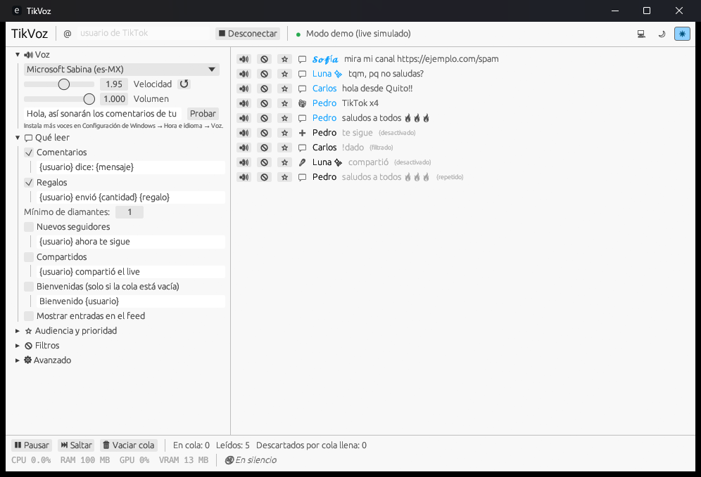
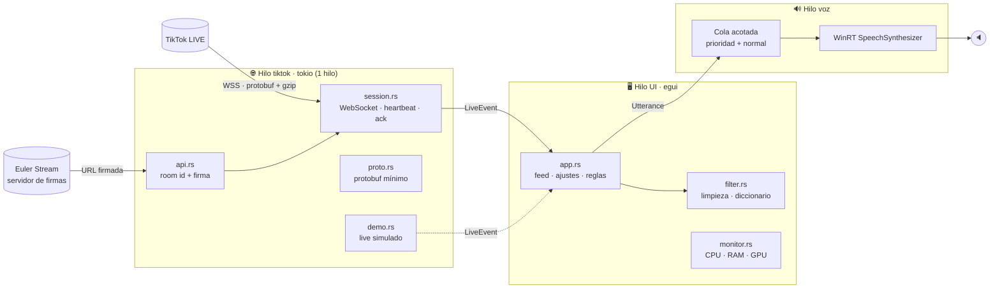
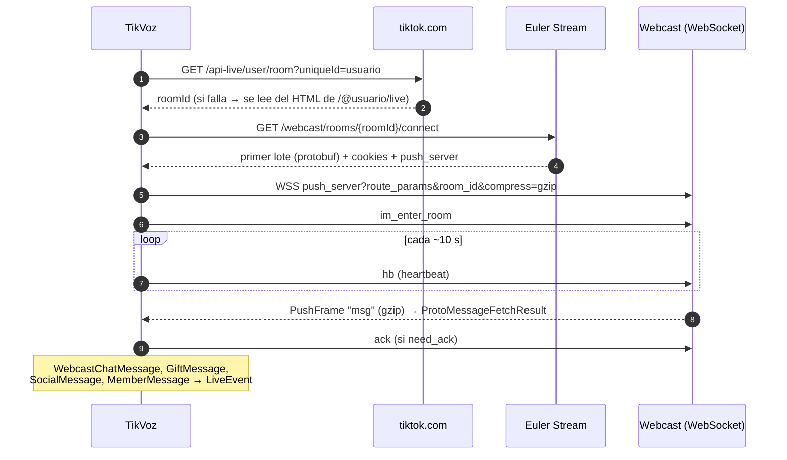
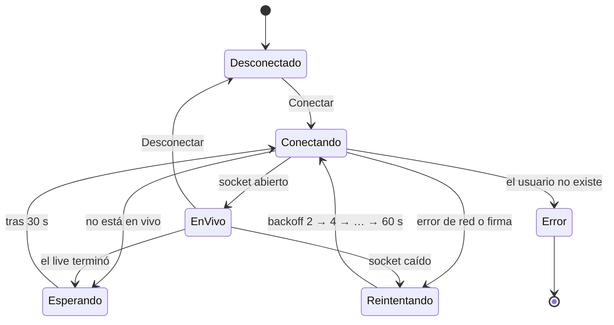
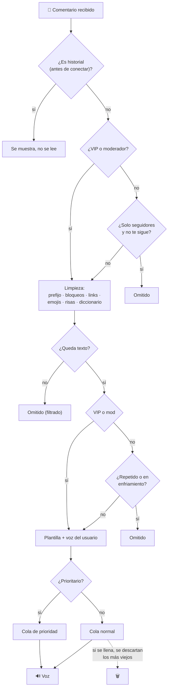

<div align="center">

# 🔊 TikVoz

**Lee en voz alta los comentarios de tu TikTok LIVE. Gratis, local y casi sin retraso.**

Un solo `.exe` de ~6,5 MB · Interfaz nativa (sin Electron ni navegador) · Voces de Windows offline


<picture>
  <source media="(prefers-color-scheme: dark)" srcset="docs/captura-oscuro.png">
  
</picture>

<sub>Captura en modo demo: los usuarios son ficticios. GitHub muestra la versión clara u oscura según tu tema.</sub>

</div>

---

## Índice

- [¿Por qué TikVoz?](#por-qué-tikvoz)
- [Instalación](#instalación)
- [Uso rápido](#uso-rápido)
- [Funciones](#funciones)
- [Cómo funciona por dentro](#cómo-funciona-por-dentro)
- [Configuración completa](#configuración-completa)
- [Rendimiento](#rendimiento)
- [Compilar desde el código](#compilar-desde-el-código)
- [Preguntas frecuentes](#preguntas-frecuentes)
- [Hoja de ruta](#hoja-de-ruta)

## ¿Por qué TikVoz?

La mayoría de los lectores de chat para TikTok son webs, apps Electron de cientos de MB o servicios de suscripción que cobran justo por las funciones útiles. TikVoz las incluye todas, gratis y en un binario nativo:

| | TikVoz | Lectores típicos |
|---|:---:|:---:|
| Precio | **Gratis** | Freemium o suscripción |
| Voz | Local, offline, sin límite | Muchas veces en la nube y con cuota |
| Latencia de la voz | **~140 ms** | 0,5–2 s (ida y vuelta a la nube) |
| RAM | **~85–100 MB** | 250–600 MB (Electron o navegador) |
| Voz por usuario, VIP, prioridad, diccionario | ✅ | 💰 normalmente de pago |
| Código abierto | ✅ | ❌ |

## Instalación

1. Descarga `tikvoz.exe` desde la sección [**Releases**](../../releases).
2. Ejecútalo. No necesita instalador, runtimes ni permisos de administrador.

> [!NOTE]
> Al ser un ejecutable nuevo y sin firma digital, Windows SmartScreen o Defender pueden avisar la primera vez. El código está aquí completo; si prefieres, [compílalo tú mismo](#compilar-desde-el-código).

## Uso rápido

1. Escribe tu `@usuario` de TikTok y pulsa **▶ Conectar**. Si todavía no estás en vivo, TikVoz espera y se conecta solo cuando empiezas.
2. Elige la voz, la velocidad y el volumen. Pulsa **Probar** para escucharla.
3. ¿No estás en vivo? Pulsa **🎭 Demo** para simular un live y ajustar todo con calma.

Accesos directos útiles:

```bash
tikvoz.exe miusuario   # conecta directo a tu live
tikvoz.exe --demo      # abre el live simulado
```

## Funciones

### 🗣️ Qué se lee

- **Comentarios, regalos, nuevos seguidores, compartidos y bienvenidas.** Cada tipo se activa por separado y tiene su propia **plantilla** (`{usuario} dice: {mensaje}`, `{usuario} envió {cantidad} {regalo}`…).
- **Regalos en combo:** se leen una sola vez al final de la racha ("Ana envió 15 Rosa"), no "rosa x1, x2, x3…".
- **Mínimo de diamantes:** ignora los regalos baratos si quieres.
- **Bienvenidas inteligentes:** solo se leen cuando la cola está vacía, para no tapar los comentarios.

### ⭐ Audiencia y prioridad

- **Voz distinta por usuario:** cada `@usuario` suena siempre con la misma voz, para que se distinga quién habla.
- **Usuarios VIP:** siempre se leen, se saltan los límites y se adelantan en la cola. Se agregan con un clic en ⭐ desde el feed.
- **Moderadores con prioridad** (🛡 en el feed).
- **Solo seguidores:** lee únicamente a quienes te siguen.
- **Enfriamiento por usuario:** evita que una sola persona acapare la voz.
- **Regalos y seguidores se adelantan** a los comentarios normales.

### 🧹 Filtros y limpieza

- Quita emojis y símbolos que la voz deletrearía.
- Reemplaza los links por "enlace".
- Acorta `jajajajajaja` a `jajaja` y `holaaaaa` a `holaaa`.
- Corta los mensajes largos sin partir palabras.
- **Anti-spam:** no repite el mismo mensaje del mismo usuario dentro de una ventana configurable.
- **Palabras bloqueadas:** omite el comentario o lo **censura** ("piip").
- **Usuarios silenciados** (🚫 desde el feed).
- **Modo prefijo:** solo lee los comentarios que empiezan con, por ejemplo, `!v`.
- **Diccionario de pronunciación** editable: `xd → equis de`, `tqm → te quiero mucho`, `pq → porque`…

### 🎛️ Control y app

- Pausar, saltar, vaciar la cola, y 🔊 para releer cualquier mensaje del feed.
- **Cola con tope:** si el chat va más rápido que la voz, se descartan los mensajes *más viejos*, así nunca vas minutos atrasado.
- **Tema claro, oscuro o del sistema** (☀ 🌙 💻).
- **Monitor de consumo** de CPU, RAM, GPU y VRAM del propio programa, en la esquina inferior izquierda.
- **Reconexión automática** con backoff exponencial y espera si el live termina.
- Los ajustes se guardan solos en `%APPDATA%\TikVoz`.

## Cómo funciona por dentro

### Arquitectura

Tres hilos que solo se comunican por mensajes, sin locks compartidos en el camino crítico:



### Conexión a un live



### Ciclo de vida de la conexión



### Qué pasa con cada comentario



### Por qué es tan liviano

- **UI de modo inmediato** (`egui` + `glow`): solo se redibuja cuando llega un evento o mueves el mouse. En reposo, la CPU queda en 0 %.
- **Red en un solo hilo** (`tokio` current-thread): para un único socket no hace falta un pool.
- **Protobuf mínimo:** se declaran solo los ~30 campos que se usan, de los miles del esquema. El build no necesita `protoc`.
- **Voz nativa del sistema:** no hay modelos de IA cargados en memoria (~13 MB en total).
- **Colas y feed acotados:** la memoria no crece aunque el live dure horas.
- **`rustls`** en vez de OpenSSL, y **LTO + `strip` + `panic=abort`** en release.

## Configuración completa

<details>
<summary><b>🔊 Voz</b></summary>

| Ajuste | Qué hace | Defecto |
|---|---|---|
| Voz | Cualquier voz instalada en Windows; se prefiere una en español | Primera en español |
| Velocidad | 0,5× a 3× | 1,0 |
| Volumen | 0 a 1 | 1,0 |

</details>

<details>
<summary><b>💬 Qué leer</b></summary>

| Ajuste | Variables | Defecto |
|---|---|---|
| Comentarios | `{usuario}` `{mensaje}` | ✅ `{usuario} dice: {mensaje}` |
| Regalos | `{usuario}` `{cantidad}` `{regalo}` | ✅ `{usuario} envió {cantidad} {regalo}` |
| Mínimo de diamantes | | 1 |
| Nuevos seguidores | `{usuario}` | ❌ |
| Compartidos | `{usuario}` | ❌ |
| Bienvenidas (solo con la cola vacía) | `{usuario}` | ❌ `Bienvenido {usuario}` |

</details>

<details>
<summary><b>⭐ Audiencia y prioridad</b></summary>

| Ajuste | Defecto |
|---|---|
| Voz distinta por usuario (entre las voces del mismo idioma) | ❌ |
| Regalos y seguidores se adelantan en la cola | ✅ |
| Moderadores con prioridad y sin límites | ✅ |
| Leer solo a quienes te siguen | ❌ |
| Enfriamiento por usuario (segundos, 0 = sin límite) | 0 |
| Usuarios VIP | — |

</details>

<details>
<summary><b>🚫 Filtros</b></summary>

| Ajuste | Defecto |
|---|---|
| No repetir el mismo mensaje del mismo usuario (ventana en segundos) | ✅ 60 s |
| Reemplazar links por "enlace" | ✅ |
| Ignorar comandos `!algo` | ✅ |
| Solo leer si empieza con… | (vacío = todos) |
| Máx. caracteres / mín. letras | 200 / 1 |
| Palabras bloqueadas · censurar en vez de omitir | — · ❌ |
| Usuarios silenciados | — |
| Diccionario de pronunciación | 13 abreviaturas comunes |

</details>

<details>
<summary><b>⚙ Avanzado</b></summary>

| Ajuste | Defecto |
|---|---|
| Máx. en cola (se descartan los más viejos) | 15 |
| Conectar al abrir la app | ❌ |
| Mostrar consumo (CPU, RAM, GPU) | ✅ |
| API key de Euler Stream (opcional, sube el límite de conexiones) | — |

</details>

## Rendimiento

Medido con el binario de release en Windows 11, con un live real y en modo demo:

| Métrica | Valor |
|---|---|
| Tamaño del `.exe` | ~6,5 MB |
| RAM privada | ~85–100 MB, estable en sesiones largas |
| CPU en reposo / con un live activo | ~0 % / < 1 % |
| Latencia de la voz | ~140 ms la primera frase, ~10 ms entre frases |
| Costo del monitor de consumo | ~1,6 ms por segundo + ~6 MB (contadores de Windows) |

> [!TIP]
> La mayor parte de la RAM es el driver de OpenGL, la base de cualquier interfaz acelerada por GPU. Si apagas el monitor en **Avanzado**, su hilo deja de medir.

## Compilar desde el código

Requisitos: [Rust](https://rustup.rs) 1.84 o superior (toolchain MSVC) y Windows 10/11.

```bash
git clone <url-de-este-repo>
cd tikvoz
cargo build --release      # → target/release/tikvoz.exe
cargo test                 # pruebas unitarias
```

Estructura:

```
src/
├── main.rs          ventana y opciones de eframe
├── app.rs           UI, reglas de lectura, feed
├── config.rs        ajustes persistentes
├── filter.rs        limpieza, diccionario, anti-spam (con tests)
├── speech.rs        hilo de voz y cola con prioridad
├── monitor.rs       CPU/RAM/GPU del proceso (API nativa de Windows)
└── tiktok/
    ├── mod.rs       supervisor con reconexión
    ├── api.rs       room id + servidor de firmas
    ├── session.rs   WebSocket, heartbeat, ack, gzip
    ├── proto.rs     esquema protobuf mínimo
    └── demo.rs      live simulado
```

## Preguntas frecuentes

**¿Necesito una cuenta o una API key?**
No. La API key de [Euler Stream](https://www.eulerstream.com/) es opcional. Solo hace falta si ves el mensaje "límite del servidor de firmas"; en ese caso créala gratis y pégala en **Avanzado**.

**¿Por qué se usa un servidor de firmas?**
TikTok exige una firma ofuscada para abrir el WebSocket del live, y esa firma cambia seguido. Todas las librerías de la comunidad, como TikTokLive y TikTok-Live-Connector, delegan este paso. TikVoz solo le envía el ID de la sala; tus comentarios no pasan por ese servidor.

**¿Cómo consigo más voces?**
En **Configuración de Windows → Hora e idioma → Voz → Agregar voces**, por ejemplo Español (España), Español (México) o Español (Colombia). Con dos o más voces del mismo idioma, activa "Voz distinta por usuario".

**¿Funciona en Linux o macOS?**
El código es multiplataforma (usa Speech Dispatcher y AVFoundation), pero hoy solo se prueba y publica para Windows.

**¿Es oficial?**
No. Es una integración no oficial con TikTok LIVE; si TikTok cambia su protocolo, puede dejar de funcionar hasta que se actualice.

## Hoja de ruta

- [ ] Voces neuronales locales (Piper) como motor opcional.
- [ ] Atajos de teclado globales (saltar / pausar sin cambiar de ventana).
- [ ] Overlay para OBS con el mensaje que se está leyendo.
- [ ] Builds para Linux y macOS.

## Licencia

[MIT](LICENSE). Úsalo, modifícalo y compártelo.
